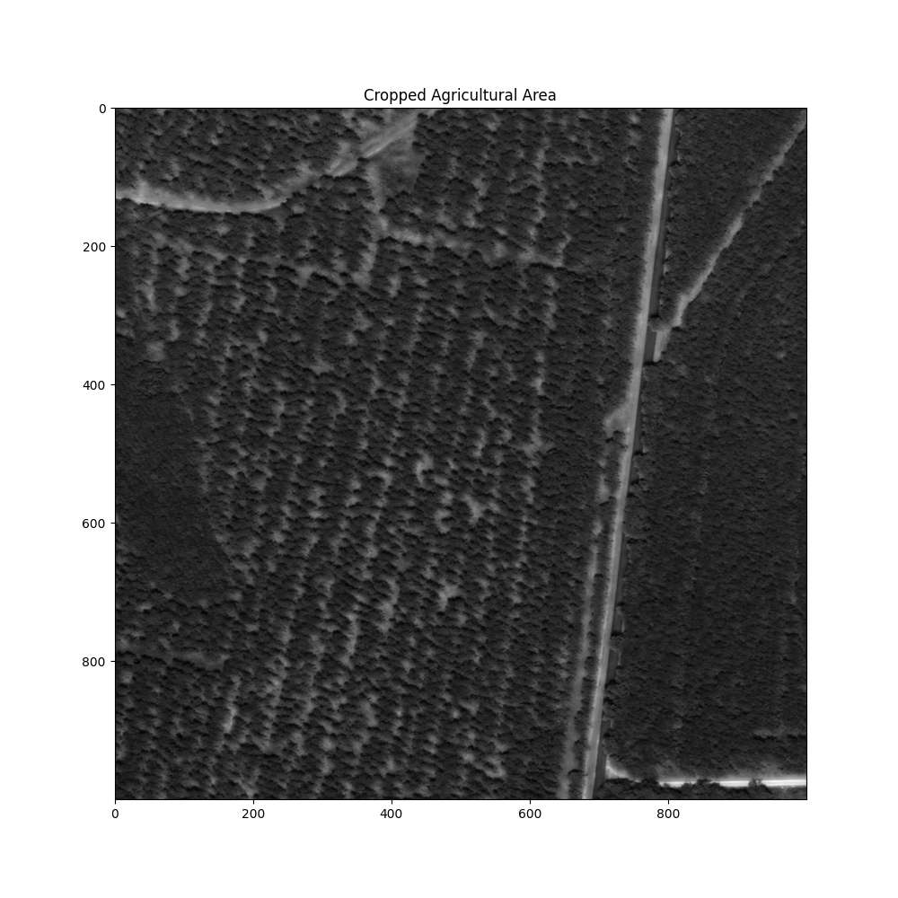
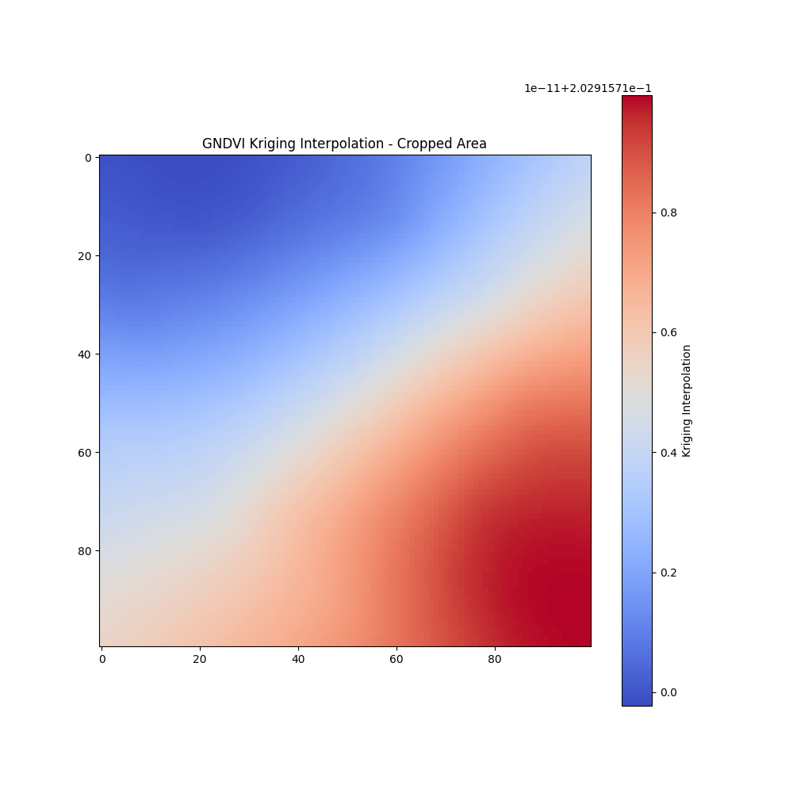
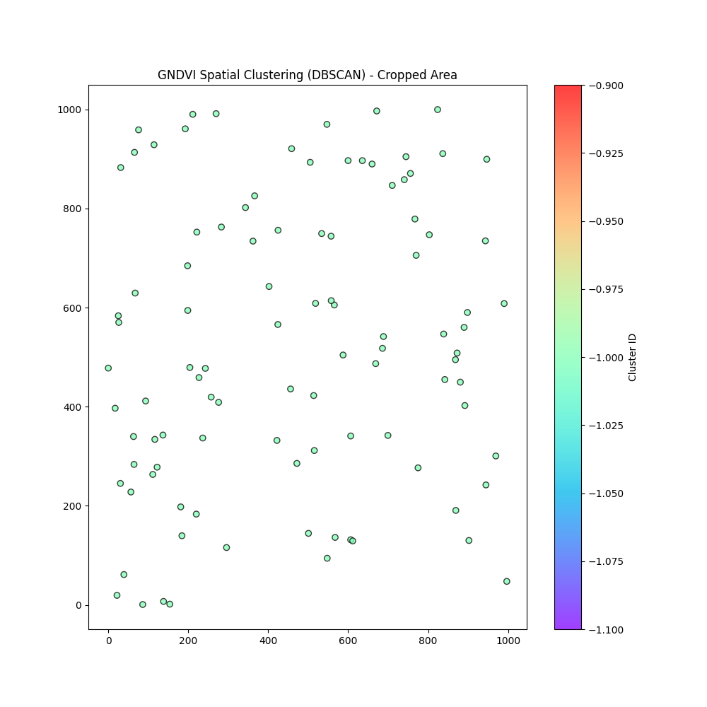

# 🛰️ AgriRaster: NDVI, Kriging and Clustering of Aerial Imagery


A Jupyter notebook for **precision-agriculture raster analysis**. It downloads an open aerial image, computes a vegetation index, interpolates it with **kriging**, and segments the field into management zones with unsupervised clustering.

| Region of interest | Vegetation index (kriging) | Clusters (DBSCAN) |
|---|---|---|
|  |  |  |

## Workflow

1. **Download** an aerial/satellite image from [OpenAerialMap](https://openaerialmap.org/).
2. **Load** the raster and crop a region of interest (ROI) with `rasterio`.
3. **Compute vegetation indices** (NDVI / GNDVI) from the spectral bands.
4. **Interpolate** the index surface with ordinary kriging (`pykrige`).
5. **Cluster** pixels with **DBSCAN** (`scikit-learn`) to delineate homogeneous zones.
6. **Visualize** every step with `matplotlib`.

## How to run

```bash
git clone https://github.com/raruizc/AgriRaster.git
cd AgriRaster
pip install rasterio numpy matplotlib scikit-learn pykrige requests jupyter
jupyter notebook AgriRaster.ipynb
```

## Author

**Ricardo Antonio Ruiz-Cardozo**: PhD candidate in Statistics and Agricultural Experimentation, ESALQ/USP.

Released under the [MIT License](LICENSE).
